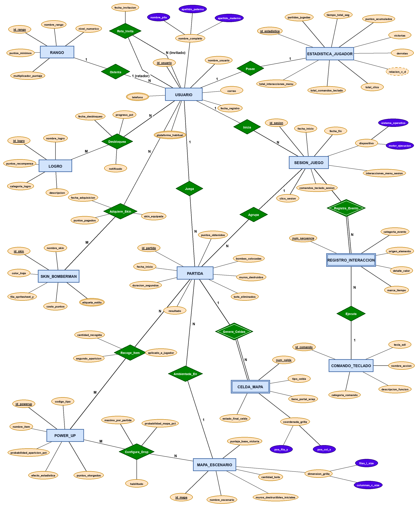

# 💣 Proyecto Final de Bases de Datos — Videojuego Bomberman (ANSI/SPARC + MySQL)

**Universidad Autónoma de Aguascalientes (UAA)**  
**Centro de Ciencias Básicas — Departamento de Sistemas de Información**  
**Materia:** Bases de Datos (BD) | **Carrera:** Ingeniería en Computación Inteligente (I.C.I.) | **Semestre:** 5°  
**Profesor:** Dr. Jaime Muñoz Arteaga  
**Fecha de entrega:** 27 de noviembre de 2026 | **Periodo:** Agosto – Diciembre 2026  

### 👥 Integrantes del Equipo #13
- **Pedro Fernando López Vázquez**
- **Santiago Andrey Muñoz Muñoz**
- **Ángel Josué Muñoz Muñoz**
- **Luis Gerardo Escamilla López**

---

## 🎮 1. Descripción del Proyecto y Fuente Original

Este proyecto desarrolla el diseño conceptual, lógico y físico de una base de datos relacional en **MySQL / MariaDB (`bomberman_db`)** bajo la arquitectura de tres niveles **ANSI/SPARC**, integrada en tiempo real con el videojuego clásico **Bomberman**.

- **Repositorio original del videojuego base:** [https://github.com/jhoukem/Bomberman](https://github.com/jhoukem/Bomberman) *(Autor: Jean-Hugo, desarrollado en C con SDL2, SDL2_image, SDL2_ttf y SDL2_mixer bajo licencia GNU GPLv3).*
- **Ampliación realizada:** Se instrumentó el código fuente en C (`src/db_telemetry.c`, `src/input.c`, `src/bomb.c`, `src/bonus.c`, `src/main.c`) y se construyó un servidor full-stack en **Node.js + Express + MySQL2** junto con un motor interactivo en **HTML5 Canvas** (`codigo_ampliado/public/bomberman_app.js`) que utiliza los recursos gráficos y sonoros originales (`rsc/spritesheet.png`, `rsc/bm.ttf`, `rsc/explosion.wav`, `rsc/power_up.wav`) para persistir en tiempo real:
  1. **Estadísticas de progreso:** Nombre de los usuarios, ID del usuario, número de partidas jugadas y tiempo total de juego en segundos.
  2. **Estadísticas de desempeño:** Número de puntos acumulados, victorias, derrotas y relación derivada victorias/derrotas (`relacion_v_d`).
  3. **Estadísticas de comportamiento e interacción:** Número de clics del ratón o pulsaciones en pantalla, comandos del teclado (`SDLK_UP`, `SDLK_DOWN`, `SDLK_LEFT`, `SDLK_RIGHT`, `SDLK_SPACE`, `SDLK_p`, `SDLK_ESCAPE`) e interacciones con los menús.

---

## 🏛️ 2. Arquitectura ANSI/SPARC Implementada

| Nivel ANSI/SPARC | Propósito en el sistema Bomberman | Artefactos en el repositorio |
| :--- | :--- | :--- |
| **Nivel Externo (Vistas)** | Exponer vistas personalizadas de progreso, desempeño (`relacion_v_d`) e historial de partidas sin exponer las tablas internas. | Vistas SQL `vw_desempeno_jugador` y `vw_historial_partidas_bomberman` en [`database/bomberman_db.sql`](database/bomberman_db.sql). |
| **Nivel Conceptual** | Definir requerimientos (`RF-01`..`RF-07`, `RD-01`), 12 entidades (10 fuertes y 2 débiles), atributos compuestos, multievaluados, derivados y 14 interrelaciones. | Diagrama MER en notación extendida de Chen: [`Diagramas/Diagrama_MER_Bomberman.xml`](Diagramas/Diagrama_MER_Bomberman.xml) y [`Diagramas/Diagrama_MER_Bomberman.png`](Diagramas/Diagrama_MER_Bomberman.png). |
| **Nivel Lógico e Interno** | Transformar el MER a 19 esquemas relacionales normalizados desde **1FN hasta 4FN**, consultas en Álgebra Relacional y tablas físicas InnoDB con índices. | Script DDL/DML completo en [`database/bomberman_db.sql`](database/bomberman_db.sql) y [`3_Base_De_Datos/bomberman_db.sql`](3_Base_De_Datos/bomberman_db.sql). |



---

## 📂 3. Estructura del Repositorio y Carpetas de Entrega

```text
├── 1_Codigo_Inicial_Bomberman/      # Entregable 1: Código C/SDL2 original intacto + URL_REPOSITORIO.txt
├── 2_Codigo_Ampliado_Bomberman/     # Entregable 2: Juego ampliado integrado a MySQL (C + Node.js/Canvas)
├── 3_Base_De_Datos/                 # Entregable 3: Script SQL completo (bomberman_db.sql)
├── 4_Reporte_Final/                 # Entregable 4: Reporte contestado (.docx y .pdf) + Diagramas MER
├── codigo_inicial/                  # Copia base del repositorio https://github.com/jhoukem/Bomberman
├── codigo_ampliado/                 # Entorno de trabajo del juego ampliado con servidor Express/MySQL2
├── database/                        # Script SQL maestro bomberman_db.sql
├── Diagramas/                       # Diagrama_MER_Bomberman.xml (draw.io) y Diagrama_MER_Bomberman.png
├── ReporteDeProyectoFinal(BaseDeDatos).doc             # Plantilla oficial UAA sin contestar
├── ReporteDeProyectoFinal_Bomberman_Contestada.docx    # Reporte final contestado en Word
└── ReporteDeProyectoFinal_Bomberman_Contestada.pdf     # Reporte final contestado en PDF
```

---

## 🚀 4. Instrucciones Paso a Paso de Instalación y Ejecución

### Paso 1: Crear y poblar la base de datos en MySQL / MariaDB
Asegúrate de tener activo tu servidor **MySQL 8.0+** o **MariaDB 10.4+** y ejecuta el script `database/bomberman_db.sql`:

```bash
mysql -h 127.0.0.1 -P 3306 -u root -p < database/bomberman_db.sql
```
*(Si utilizas XAMPP MariaDB en el puerto `3307` sin contraseña, ejecuta: `mysql -h 127.0.0.1 -P 3307 -u root < database/bomberman_db.sql`).*

### Paso 2: Configurar la conexión e instalar dependencias
Ingresa a la carpeta `codigo_ampliado/` e instala las dependencias de Node.js:

```bash
cd codigo_ampliado
npm install
```

Si es necesario, crea o ajusta el archivo `.env` en `codigo_ampliado/` con los datos de tu servidor MySQL/MariaDB:
```env
DB_HOST=127.0.0.1
DB_PORT=3307
DB_USER=root
DB_PASSWORD=
DB_NAME=bomberman_db
PORT=3000
```

### Paso 3: Ejecutar las pruebas funcionales de integración con MySQL
```bash
npm run test-db
```

### Paso 4: Iniciar el videojuego Bomberman ampliado
```bash
npm start
```
Abre tu navegador en **`http://localhost:3000`** para jugar y visualizar en tiempo real las estadísticas de la vista `vw_desempeno_jugador` y la bitácora `REGISTRO_INTERACCION`.
